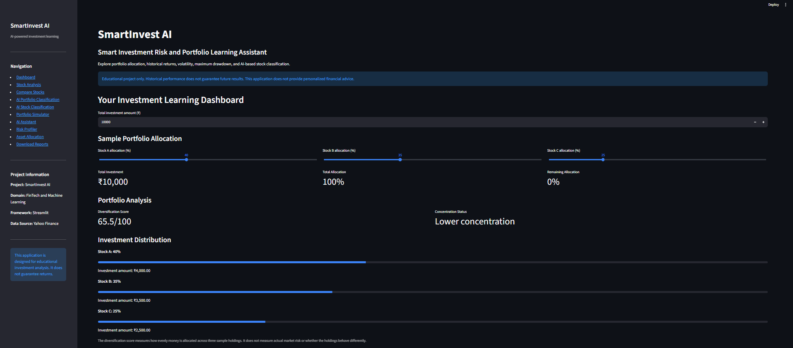
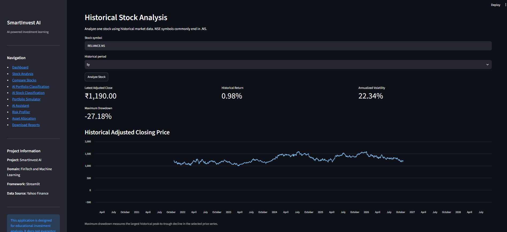
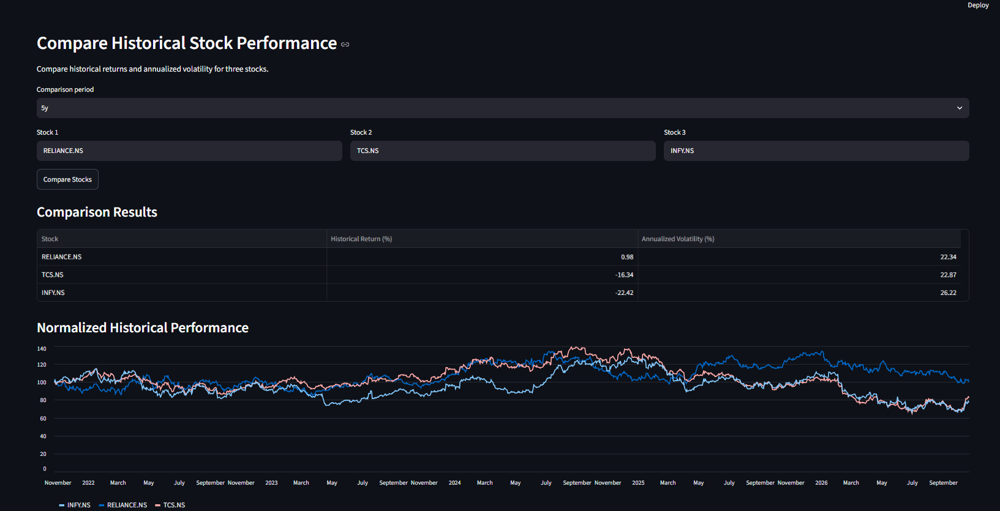
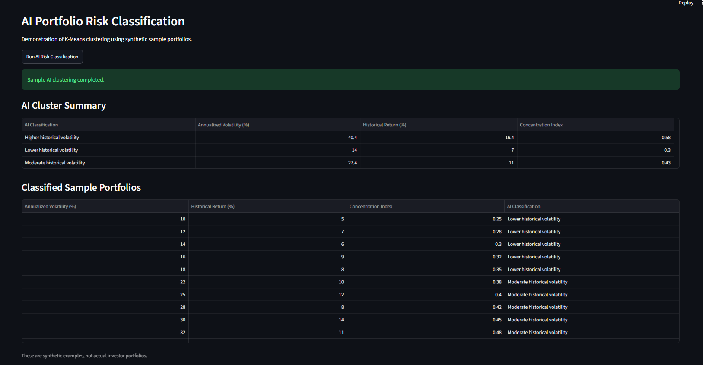
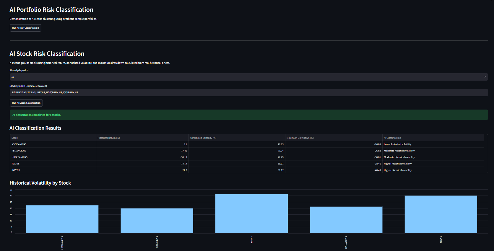
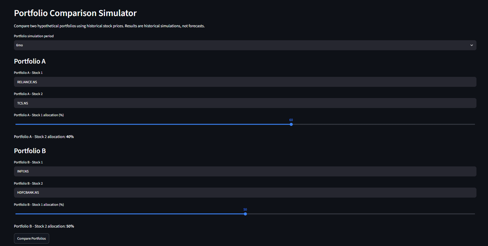
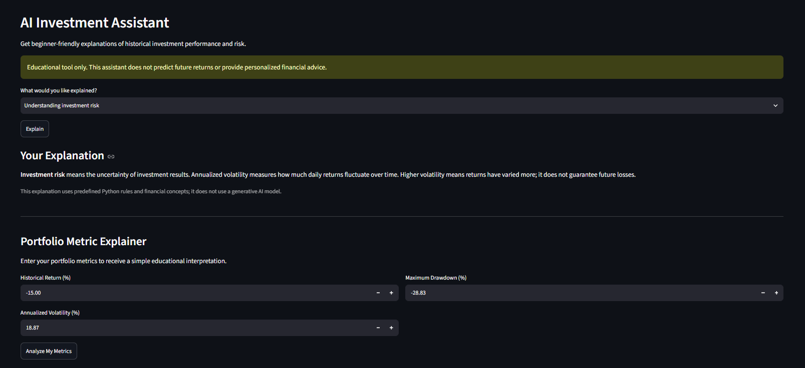
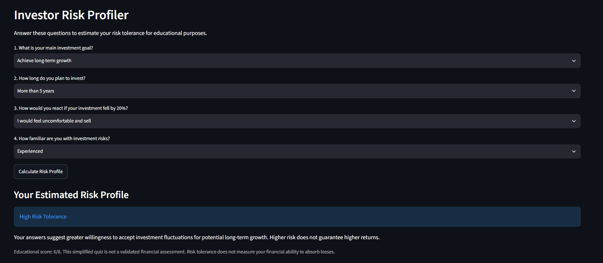
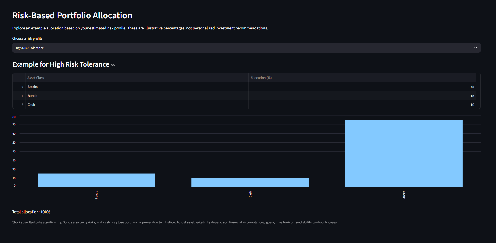
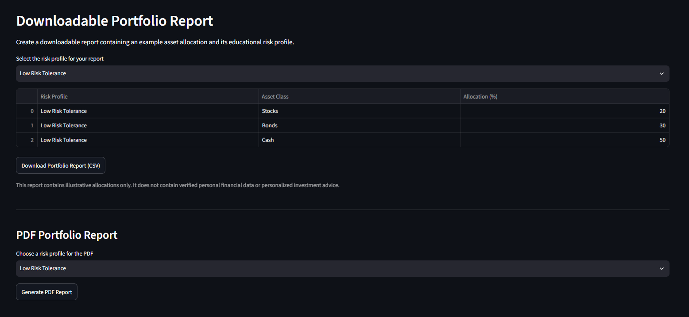

# SmartInvest AI — Smart Investment Risk & Portfolio Learning Assistant

SmartInvest AI is a Python-based web application built with Streamlit that helps users understand historical stock performance, investment risk, and portfolio diversification through interactive charts, educational explanations, and machine-learning demonstrations.

## Features

- **Investment Dashboard:** Explore investment allocations and diversification.
- **Stock Analysis:** Analyze historical returns, annualized volatility, and maximum drawdown.
- **Stock Comparison:** Compare multiple stocks using historical data.
- **Machine Learning:** Explore K-Means clustering of sample portfolios and stock risk/return metrics.
- **Portfolio Simulator:** Compare hypothetical portfolio scenarios.
- **AI Investment Assistant:** Get rule-based educational explanations.
- **Metric Explainer:** Understand investment and risk metrics in beginner-friendly language.
- **Investor Risk Profiler:** Explore risk-profile results and educational allocation examples.
- **Report Export:** Export analysis summaries in CSV and PDF formats.
- **Interactive Visualizations:** Explore charts using Plotly.

## Technology Stack

- Python
- Streamlit
- Pandas and NumPy
- Scikit-learn
- yfinance
- Plotly
- ReportLab

## Getting Started

### 1. Clone the repository

```bash
git clone https://github.com/Nagaraj-Gouda/SmartInvest-AI.git
cd SmartInvest-AI
```

### 2. Install dependencies

Create a virtual environment:

```bash
python -m venv .venv
```

Activate it on Windows:

```powershell
.\.venv\Scripts\Activate.ps1
```

Install the required packages:

```bash
python -m pip install streamlit pandas numpy scikit-learn plotly yfinance reportlab
```

### 3. Run the application

```bash
python -m streamlit run app.py
```

Open the local URL shown in the terminal, usually `http://localhost:8501`.

## Machine Learning Approach

The project demonstrates K-Means clustering to explore groups of portfolios or stocks with similar characteristics. Historical return, annualized volatility, and maximum drawdown are used in the stock-analysis clustering workflow.

Clustering is exploratory and does not predict future stock prices or generate guaranteed trading signals.

## Project Purpose

This project was developed as a Computer Science and Engineering mini project to demonstrate Python programming, data analysis, visualization, and introductory machine learning through a practical financial-education application.

## Limitations

- Historical market data depends on the availability and quality of the external data provider.
- An internet connection is required for online historical data retrieval.
- Historical performance does not guarantee future results.
- The application is for educational purposes and is not personalized financial advice.

## Repository

[View SmartInvest AI on GitHub](https://github.com/Nagaraj-Gouda/SmartInvest-AI)

## Author

**Nagaraj Gouda**  
Computer Science and Engineering student  
RNS Institute of Technology, Bengaluru


## Application Screenshots

### 1. Dashboard


### 2. Stock Analysis


### 3. Compare Stocks


### 4. AI Portfolio Classification


### 5. AI Stock Classification


### 6. Portfolio Simulator


### 7. AI Assistant


### 8. Risk Profiler


### 9. Asset Allocation


### 10. Download Reports

